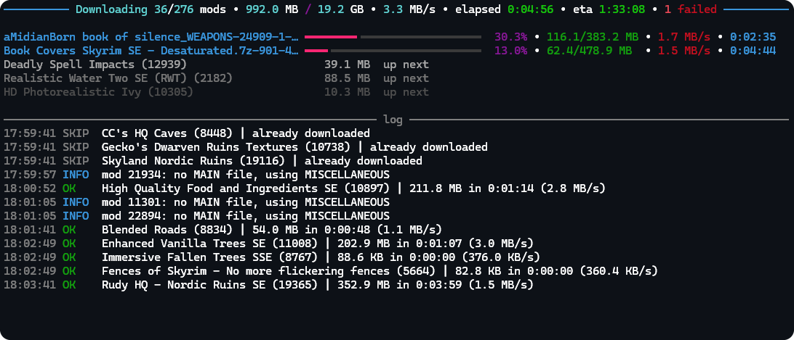

<h1 align="center">nexus-downloader</h1>

A command-line bulk downloader for [Nexus Mods](https://www.nexusmods.com). Drop
a list of mod links into `mods.txt` and it works through them one by one,
picking the right file, downloading it and optionally unpacking it.

<br>

<p align="center">
  
</p>

## Desktop GUI (Windows)

Download the Windows portable EXE bundle from [Releases](https://github.com/Ayulog/nexus-downloader/releases), extract it, and open `NexusDownloader.exe`. For source checkouts, double-click `Start-GUI.cmd` for the Chinese desktop interface. First-run setup uses a project-local virtual environment; Python 3.11+ with Tcl/Tk or `uv` is required. See [the GUI guide](README-GUI.zh-CN.md) for login, settings and testing. The original CLI remains available.

## Setup

```bash
pip install -r requirements.txt
```

The first run creates `config.toml` and an empty `mods.txt`. Then:

1. Log in on nexusmods.com, open the browser dev tools (**Application >
   Cookies**) and copy the value of `nexusmods_session` into `session_cookie`
   in `config.toml`.
2. Put your mod links into `mods.txt`, one per line:

```
https://www.nexusmods.com/skyrimspecialedition/mods/12604
https://www.nexusmods.com/skyrimspecialedition/mods/266
```

## Run

```bash
python main.py
```

On the first start a browser window opens for the Nexus login. The session is
stored in `~/.nexus_session.json` and refreshed automatically after that.

## Configuration

Everything lives in `config.toml`:

| Setting | What it does |
|---|---|
| `file_categories` / `fallback_categories` | Which file categories to download, and what to try if a mod has none of them |
| `max_parallel` | Downloads at the same time (default 2) |
| `request_delay_s` | Pause between download link requests |
| `[extract] enabled` | Unpack archives after download, `delete_archive_after` removes them |
| `log_dir` | One log file per run with sizes, speeds and a failure summary |

## Notes

- Archives are unpacked with Python (`zipfile`, `py7zr`). `.rar` files and the
  few 7z variants py7zr can't read go through [7-Zip](https://www.7-zip.org)
  if it is installed.
- Download speed is whatever Nexus gives your account. Free accounts are
  throttled per account, so more parallel downloads won't make it faster.
- If every download suddenly fails with "session cookie probably expired",
  grab a fresh `nexusmods_session` cookie.

## Disclaimer

**Not affiliated.** This is an independent, unofficial project. It is not
affiliated with, endorsed by, sponsored by or otherwise connected to Nexus Mods,
Black Tree Gaming Ltd. or the Vortex mod manager. "Nexus Mods", "Vortex" and all
related names, logos and trademarks belong to their respective owners and are
used here only to describe what this tool works with.

**Educational purpose.** The code is published for educational, research and
interoperability purposes only, to document how a mod manager talks to Nexus
Mods. It relies on internal, undocumented endpoints that are not meant for
public use and may change, break or be blocked at any time.

**No content is distributed.** This repository contains no mods, files, account
data or credentials. It only downloads what the person running it is already
allowed to download with their own Nexus Mods account. Session data stays on
the user's machine.

**Your responsibility.** By using this software you accept sole responsibility
for how you use it. You must comply with the Nexus Mods Terms of Service, the
licences and permissions set by each mod author, and all applicable laws in
your jurisdiction. Do not use it to overload Nexus Mods' servers, to
redistribute other people's work, or to get around account limits or paid
features. Using automated tools may violate the Terms of Service and can lead
to restrictions on your account; that risk is entirely yours.

**No warranty, no liability.** The software is provided "as is", without
warranty of any kind. The author is not liable for any claim, damage, account
suspension, data loss or other consequence arising from its use or misuse. If
you do not agree with this, do not use the software.

**Takedown.** If you are a rights holder or represent Nexus Mods and have a
concern about this repository, please open an issue and it will be addressed
or removed promptly.

## License

[`MIT LICENSE`](LICENSE). Provided "as is", without warranty.
